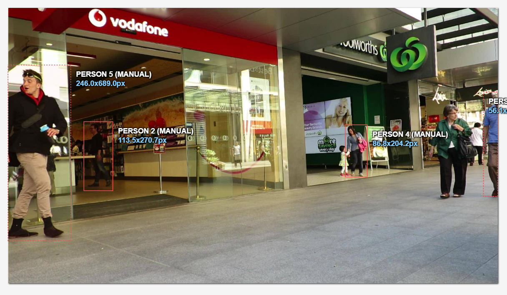
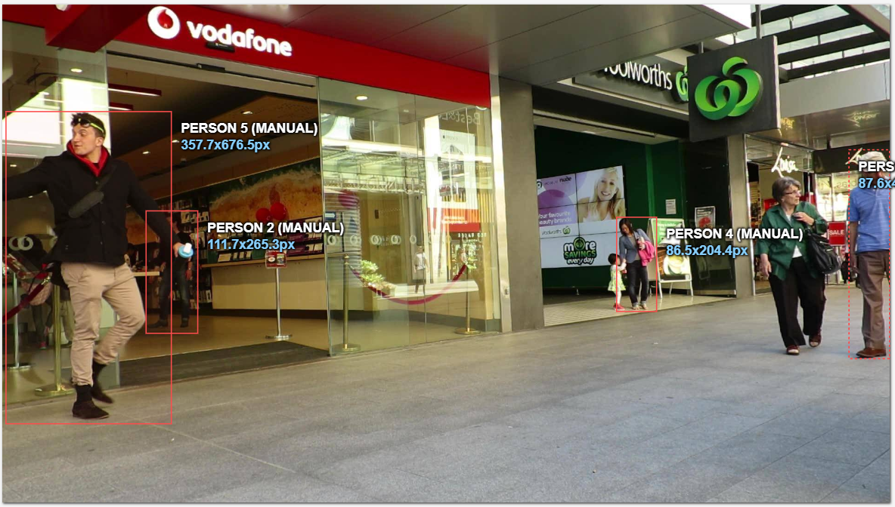
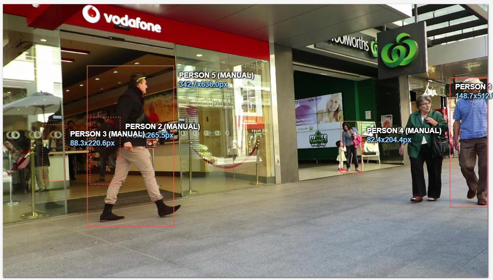

# Báo cáo cá nhân — DuongQuocHuy-2A202603311

Đoạn video: MOT17-09, 150 frame (frame 1–150), nguồn MOTChallenge, giấy phép CC BY-NC-SA 3.0.

## 0. Thông tin học viên

- Họ tên: Dương Quốc Huy
- MSSV: 2A202603311
- Mã đề: C 
- Email: duongquochuy1107@gmail.com
- Link repository: https://github.com/dqhuy11/K5-L2B-DAY05-DuongQuocHuy-2A202603311-MOTTracking
- Giờ bắt đầu: 16h45 13/11/2026
- Giờ kết thúc:  12h00 14/11/2026

Số frame trong báo cáo ghi theo CVAT (0–149). Bảng đối chiếu ID:

| Mã | Mô tả nhận diện | ID trên CVAT | ID trong `gt.txt` |
|---|---|---|---|
| P1 | Nam áo đen trong cửa hàng Vodafone, sau kính | Person 2 | 2 |
| P2 | Nữ áo sáng sau kính, góc trái cửa hàng Vodafone | Person 3 | 5 |
| P3 | Ông áo xanh sọc, đội mũ trắng, vào từ mép phải | Person 1 | 1 |
| P4 | Nữ dắt bé gái váy trắng trước cửa Woolworths | Person 4 | 3 |
| P5 | Nam áo khoác đen, quần be, đeo túi, vào từ mép trái | Person 5 | 4 |

## 1. Xem trước đoạn video (CP0)

Ghi **trước khi vẽ**, mỗi người một dòng.

| Mã | Frame xuất hiện | Frame cuối thấy được | Rẽ / dừng / đổi tốc độ ở frame | Bị che ở frame | Ghi chú |
|---|---|---|---|---|---|
| P1 | 0 | 149 | Đi chậm sang phải 0–100; chậm lại ~20–40; dừng ~100–149; từ ~120 đi về phía camera (box cao dần) | 30–59 (khuất hẳn 40–49) | P5 đi ngang phía trước che P1. Đây là người dùng cho CP2 |
| P2 | 40 | 149 | Đi sang phải 40–90; chậm lại 90–110; dừng và hơi lùi lại từ ~110, đi về phía camera (box cao dần) | 40–69 (một phần) | Ở sau kính, box nhỏ; bị P5 và khung cửa kính che |
| P3 | 0 (bị cắt ở mép phải) | 149 | Đi về phía camera và sang trái, **tăng tốc** từ ~100; box cao từ 183 lên 957 px | 0–39 (bị cắt ở mép khung) | Người đổi kích thước nhiều nhất |
| P4 | 0 | 110 | Đi chậm 0–20, **đứng yên** từ ~40 | 102–110 bị bà áo xanh che, sau đó khuất hẳn sau bà áo xanh và P3 tới hết đoạn | Ở xa, box nhỏ (~204 px) |
| P5 | 0 (bị cắt ở mép trái) | 139 | Tăng tốc 20–60; chậm dần 60–110; đi ra xa camera (box cao từ ~690 xuống ~360 px) | 0–19 (cắt mép); 111–139 bị bà áo xanh rồi P3 che; khuất hẳn 120–~124 và từ ~137 | Đi ngang qua trước P1 và P2 |

## 2. Keyframe và thời gian (CP1, CP4)

Số keyframe lấy từ kết quả `src/check_submission.py`.

| Mã | Số keyframe | Keyframe ở frame | Số frame có mặt | Keyframe / 100 frame | Thời gian (phút) | Chỗ khó |
|---|---|---|---|---|---|---|
| P1 | 10 | 0, 20, 30, 50, 60, 80, 100, 120, 140, 149 | 140 | 7.1 | 30p | Đoạn bị P5 che 30–59, phải ước lượng box toàn thân sau kính |
| P2 | 8 | 40, 50, 60, 70, 90, 110, 130, 149 | 110 | 7.3 | 15p | Xuất hiện sau kính và bị che ngay khi vào; dừng rồi lùi lại ~110 |
| P3 | 11 | 0, 7, 10, 20, 40, 60, 80, 100, 120, 140, 149 | 150 | 7.3 | 40p | Bị cắt mép phải 0–39; box to gấp ~5 lần; tăng tốc cuối đoạn |
| P4 | 6 | 0, 1, 21, 41, 61, 101 | 111 | 5.4 | 15p | Bị bà áo xanh đi ngang che rồi mất hẳn |
| P5 | 10 | 0, 7, 20, 28, 40, 60, 80, 100, 110, 130 | 130 | 7.7 | 30p | Bị cắt mép trái; đổi tốc độ; bị che hai lần cuối đoạn |
| **Tổng** | **45** | | **641** | **7.0** | 130p | |

Keyframe / 100 frame của cả bài = tổng keyframe ÷ tổng số frame có mặt × 100 = 45 ÷ 641 × 100 = **7.0**.

Bạn đặt keyframe nhiều nhất ở người nào? Vì sao (người đó rẽ, dừng, lại gần camera hay bị che)?

Nhiều nhất là **P3 (11 keyframe)**. P3 đi **lại gần camera**: chiều cao box tăng từ 183 px ở frame 0 lên 957 px ở frame 149, và **tăng tốc** sang trái từ frame ~100 (tâm box đi ~3,7 px/frame ở đoạn 80–100, ~8 px/frame ở đoạn 120–140). Nội suy tuyến tính giả định kích thước và vận tốc đổi đều, nên ở đây box nội suy bị nhỏ hơn và chậm hơn người thật. Ngoài ra 0–39 P3 bị cắt ở mép phải khung hình: phần nhìn thấy tăng dần không đều, nên phải thêm keyframe dày ở 7, 10, 20. P1 và P5 đứng sau (10 keyframe) vì có đoạn bị che và đổi tốc độ. P4 ít nhất (6) vì gần như đứng yên từ frame ~40.

## 3. Đoạn bị che (CP2)

Người bị che: `P1` (CVAT: Person 2, `gt.txt`: ID 2). Người che là P5 đi ngang phía trước.

| Mốc | Frame |
|---|---:|
| Bắt đầu bị che một phần (bật `occluded`) | 30 |
| Mất hẳn (bật `outside`) | 40 |
| Hiện lại (tắt `outside`) | 50 |
| Thấy rõ trở lại (tắt `occluded`) | 60 |

- Thời gian khuất hẳn: 10 frame (40–49) = 0,33 giây.
- Quyết định: **giữ cùng ID**.
- Lý do:
  1. Khuất 10 frame, ít hơn nhiều so với ngưỡng 60 frame của lớp.
  2. Ngoại hình khớp: cùng áo đen, quần xanh, cùng kích thước (box cao ~265 px trước và sau đoạn che), vẫn ở trong cửa hàng sau kính.
  3. Chỗ hiện lại đúng hướng và tốc độ: trước khi che P1 đi sang phải ~1,3 px/frame (tâm x 356 → 369 ở frame 20 → 30); hiện lại ở tâm x 404 tại frame 50, đúng phía bên phải với tốc độ tương đương. P5 đi qua phía trước rồi đi tiếp, P1 không đổi hướng.

Kiểm trong `gt.txt`: ID 2 không có dòng nào ở `frame_id` 41–50 (CVAT 40–49); các frame `occluded` vẫn có dòng với cột visibility = 0.

Ảnh chụp màn hình (nguồn ảnh: MOT17, MOTChallenge (Milan et al., 2016)):





## 4. Tự review ID (CP3)

Lượt 1 theo người (đi ngược từ frame 149 về 0 trên CVAT), lượt 2 theo cảnh (nhảy 10 frame).

| Frame | Mã người | Loại lỗi | Mô tả một câu | Phát hiện ở lượt | Đã sửa? |
|---:|---|---|---|---|---|
| 102–107 | P4 | `flag` | P4 bị bà áo xanh (không thuộc 5 người) che dần nhưng chưa bật `occluded` | 1 | đã sửa |
| 108–110 | P4 | `flag` | P4 đã khuất hẳn sau bà áo xanh nhưng vẫn còn box; `outside` bật muộn ở 111 | 2 | đã sửa |
| 111–119 | P5 | `flag` | P5 đi ra sau bà áo xanh, chỉ còn thấy một phần nhưng thiếu `occluded` | 1 | đã sửa |
| 125–129 | P5 | `lost` | Vẫn thấy chân P5 (quần be, giày đen) giữa bà áo xanh và P3 nhưng track đang `outside` | 2 | đã sửa |
| 137–139 | P5 | `flag` | P5 đã khuất hẳn sau P3 nhưng chưa bật `outside` (bật ở 140) | 1 | đã sửa |

Không phát hiện `id_switch`, `fragmentation`, `merge`, `false_track` hay `drift`: mỗi người giữ đúng một ID suốt đoạn, script không có cảnh báo nhảy tâm box, đổi chiều cao hay IoU chồng nhau.

Tổng hợp số lỗi theo loại:

| `id_switch` | `fragmentation` | `lost` | `merge` | `false_track` | `drift` | `flag` |
|---:|---:|---:|---:|---:|---:|---:|
| 0 | 0 | 1 | 0 | 0 | 0 | 4 |

Lỗi nào chỉ lượt 2 (theo cảnh) mới thấy, lượt 1 (theo người) không thấy? Vì sao?

Hai lỗi chỉ lượt 2 mới thấy:

- **P4, frame 108–110:** ở lượt 1, chỉ nhìn P4 thì box vẫn đứng đúng chỗ cũ (P4 đứng yên) nên trông bình thường. Ở lượt 2, nhìn cả cảnh mới thấy box P4 đang nằm đè lên bà áo xanh, phía sau không còn thấy P4.
- **P5, frame 125–129:** ở lượt 1, P5 đang `outside` nên không có box để nhìn. Ở lượt 2, nhìn cả cảnh mới thấy một đôi chân quần be giữa bà áo xanh và P3 mà không có box nào.

Lỗi kiểu "box còn mà người đã mất" hoặc "người còn mà không có box" chỉ lộ ra khi so box với toàn cảnh. Theo dõi một người thì dễ bị box dẫn mắt.

## 5. File xuất và kết quả tự kiểm (CP4)

| Kiểm tra | Kết quả |
|---|---|
| Tên file MOT 1.1 | `src/exports/DuongQuocHuy_mot.zip` |
| Tên file CVAT for video 1.1 | `src/exports/DuongQuocHuy_cvat_video.zip` |
| Số track ID khác nhau trong `gt/gt.txt` (phải là 5) | 5 (ID 1–5, tổng 641 box) |
| Frame `outside` không có dòng trong `gt.txt` (đúng / sai) | Đúng (ví dụ ID 2 = P1 không có dòng ở `frame_id` 41–50) |
| Job đã completed trên CVAT máy cá nhân | đã completed |

Dán phần tóm tắt in ra từ `src/check_submission.py`:

```text
=== File MOT 1.1: DuongQuocHuy_mot.zip ===
  Số track ID: 5   |   Tổng số box: 641
  [OK]        Đúng 5 track ID.

  Track | Frame có mặt | Số frame | Đoạn vắng (outside)
      1 |   0–149      |      150 | -
      2 |   0–149      |      140 | 40–49
      3 |   0–110      |      111 | -
      4 |   0–139      |      130 | 120–129
      5 |  40–149      |      110 | -

=== File CVAT for video 1.1: DuongQuocHuy_cvat_video.zip ===

  Track | Nhãn   | Frame thấy | Keyframe | KF/100 frame | Frame occluded | Lần bật outside
      0 | person |        150 |       11 |          7.3 |             40 |               0
              Track 0: keyframe ở frame [0, 7, 10, 20, 40, 60, 80, 100, 120, 140, 149]
      1 | person |        140 |       10 |          7.1 |             20 |               1
              Track 1: keyframe ở frame [0, 20, 30, 50, 60, 80, 100, 120, 140, 149]
      2 | person |        110 |        8 |          7.3 |             30 |               0
              Track 2: keyframe ở frame [40, 50, 60, 70, 90, 110, 130, 149]
      3 | person |        111 |        6 |          5.4 |              0 |               1
              Track 3: keyframe ở frame [0, 1, 21, 41, 61, 101]
      4 | person |        130 |       10 |          7.7 |             30 |               2
              Track 4: keyframe ở frame [0, 7, 20, 28, 40, 60, 80, 100, 110, 130]

  Tổng: 45 keyframe / 641 frame có mặt = 7.0 keyframe / 100 frame
  [OK]        Đọc được 5 track từ annotations.xml.

=== Tóm tắt ===
  Lỗi: 0   |   Cảnh báo: 0
  Đạt. Dán phần tóm tắt này vào báo cáo mục 5.
```

## 6. Ba câu kết

1. Nếu được gán lại, bạn sẽ đặt keyframe khác ở đâu? Vì sao?

   - **P4:** bỏ keyframe ở frame 1 vì trùng hệt frame 0. Thay vào đó đặt keyframe ngay trước khi bị che (~101) và ở frame mất hẳn (~108), vì nguyên tắc "ngay trước khi che, ngay sau khi hiện lại" (mục 4 `docs/GUIDELINE.md`).
   - **P5:** thêm keyframe ở ~111 (bắt đầu bị che), ~125 (hiện lại một phần) và ~137 (mất hẳn sau P3). Đoạn 110–140 người này bị che liên tục, còn đổi tốc độ và co nhỏ dần, nên khoảng 20 frame giữa hai keyframe là quá dài.
   - **P3:** thêm một keyframe ở ~30. Đoạn 20 → 40 bề rộng box nhảy từ 57 lên 125 px khi người bước từ mép phải vào khung, nên nội suy tuyến tính không bám kịp.

2. Có chỗ nào bạn không chắc "cùng ID hay ID mới"? Bạn đã quyết định và ghi chú thế nào?

   Chỗ không chắc là **P5 ở frame 130**, sau đoạn `outside` 120–129: lúc này chỉ thấy một phần nhỏ thân người giữa bà áo xanh và P3. Mình **giữ cùng ID** vì (1) khuất 10 frame, dưới ngưỡng 60 frame; (2) phần nhìn thấy khớp ngoại hình: quần be, giày đen, áo khoác đen; (3) vị trí hiện lại ở bên phải chỗ mất, đúng hướng đi sang phải và tốc độ cũ (~12 px/frame). P4 sau frame 111 không hiện lại trong đoạn (bị bà áo xanh rồi P3 che tới frame 149), nên không phải quyết định tạo track mới.

3. Một lỗi ID trong job của bạn (nếu không còn sót, chọn lỗi đã sửa) có thể làm xe tự lái dự đoán sai chuyển động của người đó như thế nào? Lỗi đó ảnh hưởng MOTA hay IDF1 nhiều hơn?

   Chọn tình huống dễ xảy ra nhất trong job: ở frame 108–110, box P4 nằm đè lên bà áo xanh mà không có cờ. Nếu lúc sửa kéo nhầm box P4 sang bà áo xanh, ID của P4 sẽ chuyển sang người khác (`id_switch`). Khi đó vận tốc tính từ nhãn của "P4" nhảy từ ~0 (đang đứng yên) sang vận tốc của một người đang đi về phía camera, trong 1/30 giây. Mô hình dự đoán học từ nhãn này sẽ cho rằng người đứng yên có thể bất ngờ lao ra đường, hoặc sẽ nối quỹ đạo hai người thành một. Xe sẽ phanh gấp vô cớ, hoặc tệ hơn là đánh giá sai hướng đi của người thật.

   Lỗi này ảnh hưởng **IDF1 nhiều hơn MOTA**. MOTA chỉ cộng 1 IDSW cho mỗi lần đổi ID, rất nhỏ so với tổng FN + FP. IDF1 lại đo xem mỗi ID có bám đúng một người suốt đoạn không, nên toàn bộ các frame sau lần đổi ID đều bị tính là sai danh tính (IDFN + IDFP).

## Bonus (nếu làm)

Không làm bonus.

## 7. Tài liệu tham khảo và công cụ AI đã dùng

- Tài liệu: `README.md`, `RULES.md`, `CHECKPOINTS.md`, `RUBRIC.md`, `docs/GUIDELINE.md`, `docs/MOT_FORMAT.md`, `docs/CVAT_CHEATSHEET.md` và slide lý thuyết Ngày 5.
- Dữ liệu: MOT17-09, MOTChallenge (Milan et al., 2016), CC BY-NC-SA 3.0.
- Công cụ AI: Claude Code (Anthropic). Dùng để đọc hai file xuất, chạy `src/check_submission.py`, tổng hợp số keyframe và đoạn `occluded` / `outside` của từng track, vẽ box lên frame để soát cờ quanh frame 100–140, và hỗ trợ viết báo cáo. Toàn bộ nhãn được gán thủ công trên CVAT. Các lỗi ghi ở mục 4 đã được mình xem lại trên CVAT.
